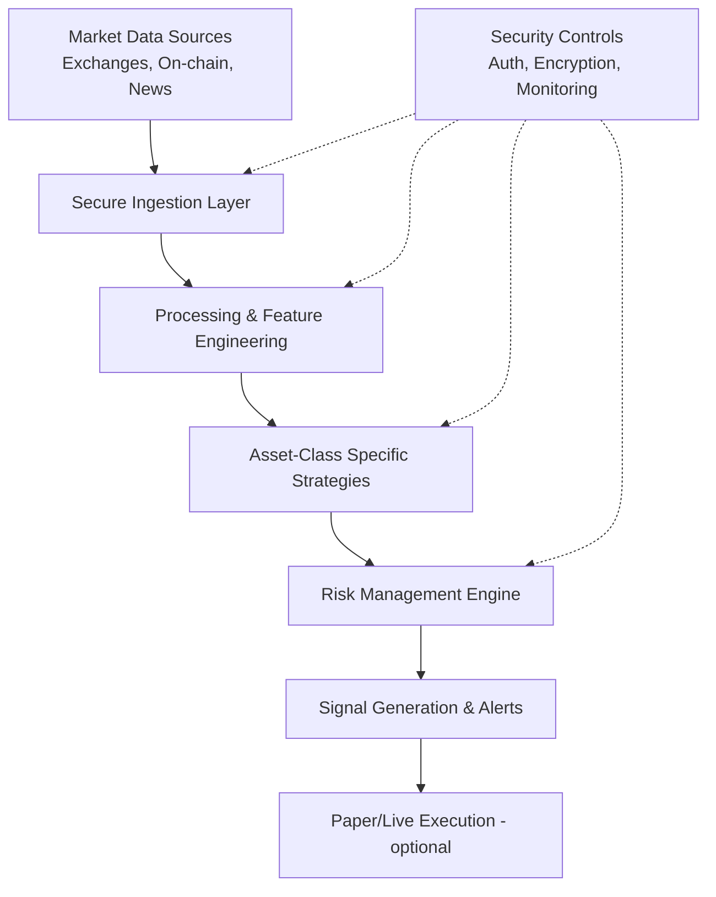

# Automated Cryptocurrency Trading Information System

> Enhanced automated trading information system with per-asset-class strategies, robust cyber and data security architecture. Designed with AI-agent harness principles for safe, auditable development.

[](https://github.com/kkzee92/automated-crypto-trading-system/actions/workflows/ci.yml)
 

## Overview
This repository provides a modular framework for automated cryptocurrency trading information systems. It includes:

- Multi-asset class trading strategies (majors, alts, DeFi, stablecoins, etc.)
- Real-time data aggregation and signal generation
- Risk management and position sizing
- Comprehensive cyber and data security architecture
- CI/CD gates, secret scanning, and compliance checks

**Disclaimer:** This is for educational and informational purposes only. Not financial advice. Cryptocurrency trading involves substantial risk of loss. Always perform your own due diligence and risk assessment.

## Key Features
- **Asset Class Strategies:** Tailored approaches for BTC/ETH (majors), mid-cap alts, DeFi tokens, stablecoin yields, and high-volatility assets.
- **Security Architecture:** Zero-trust principles, encryption at rest/transit, API key management, audit logging, and anomaly detection.
- **Data Pipeline:** Secure ingestion from exchanges (Binance, Coinbase, etc. via public APIs), on-chain data, and sentiment sources.
- **Backtesting & Simulation:** Offline-capable for testing strategies.
- **AI Agent Safe:** Follows AGENTS.md rules, PDPA/GDPR-like data handling, no secrets in code.

## Architecture
See [docs/architecture.md](docs/architecture.md) for detailed diagrams.



## Quick Start
```bash
python3 -m venv .venv && source .venv/bin/activate
pip install -r requirements.txt
python -m crypto_trading demo
```

## Asset Class Strategies Summary
| Asset Class | Example Assets | Strategy Focus | Risk Level |
|-------------|----------------|----------------|------------|
| Majors | BTC, ETH | Trend following, mean reversion | Medium |
| Large Alts | SOL, BNB, ADA | Momentum + volume confirmation | Medium-High |
| DeFi | UNI, AAVE, LINK | Yield + volatility harvesting | High |
| Stablecoins | USDT, USDC | Arbitrage, yield farming signals | Low |
| High Vol | Memecoins, new listings | Strict position limits, stop-losses | Very High |

Detailed strategies in [docs/trading-strategies.md](docs/trading-strategies.md).

## Security
See [SECURITY.md](SECURITY.md) and [docs/security-architecture.md](docs/security-architecture.md).

## Licence
[MIT](LICENSE)
