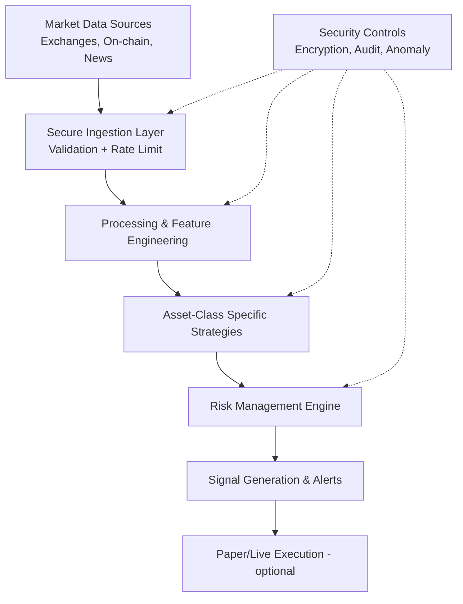

# Automated Cryptocurrency Trading Information System

> Enhanced automated trading information system with per-asset-class strategies, robust cyber and data security architecture. Designed with AI-agent harness principles for safe, auditable development.

[](https://github.com/kkzee92/automated-crypto-trading-system/actions/workflows/ci.yml)
 

## Overview
This repository provides a modular framework for automated cryptocurrency trading information systems. It includes:

- Multi-asset class trading strategies (majors, large alts, DeFi, stablecoins, high-volatility)
- Secure real-time data aggregation, feature engineering, and signal generation
- Advanced risk management with asset-class specific limits and drawdown controls
- Comprehensive cyber and data security architecture (encryption, audit logging, anomaly detection, validation)
- CI/CD gates, synthetic data mode for safe development

**Disclaimer:** This is for educational and informational purposes only. Not financial advice. Cryptocurrency trading involves substantial risk of loss. Always perform your own due diligence and risk assessment. No live trading execution is enabled by default.

## Key Features
- **Asset Class Strategies:** Tailored, indicator-driven approaches with confidence scoring and dynamic sizing for BTC/ETH (majors), large alts, DeFi tokens (with protocol metrics), stablecoin arb/yield, and high-vol assets with strict controls.
- **Security Architecture:** Zero-trust principles, Fernet encryption helpers, hash-chained audit logs, HMAC verification, input validation, rate limiting, anomaly detection.
- **Data Pipeline:** Secure ingestion from public exchange APIs (Binance example), synthetic fallback, basic technical features (EMA, RSI).
- **Risk Engine:** Volatility-adjusted sizing, class multipliers, exposure checks, drawdown halt.
- **AI Agent Safe:** Follows AGENTS.md rules, synthetic data, no secrets in code, PDPA/GDPR-like handling.

## Architecture
See [docs/architecture.md](docs/architecture.md) for detailed diagrams.



## Quick Start
```bash
python3 -m venv .venv && source .venv/bin/activate
pip install -r requirements.txt
python -m crypto_trading demo
```

Set `ENCRYPTION_KEY` (Fernet key) and optionally `EXCHANGE_API_KEY` for live data. Use synthetic mode by default for safety.

## Asset Class Strategies Summary
| Asset Class | Example Assets | Strategy Focus | Risk Level |
|-------------|----------------|----------------|------------|
| Majors | BTC, ETH | Hybrid trend (EMA) + mean reversion (RSI) + funding | Medium |
| Large Alts | SOL, BNB, ADA | Relative strength vs BTC + momentum | Medium-High |
| DeFi | UNI, AAVE, LINK | Protocol metrics (TVL, fees) + price | High |
| Stablecoins | USDT, USDC | Peg arb + yield differentials | Low |
| High Vol | Memecoins, new listings | Strict position limits, volume/ATR filters | Very High |

Detailed strategies in [docs/trading-strategies.md](docs/trading-strategies.md).

## Security
See [SECURITY.md](SECURITY.md) and [docs/security-architecture.md](docs/security-architecture.md). New module: `src/crypto_trading/security.py`.

## Licence
[MIT](LICENSE)
